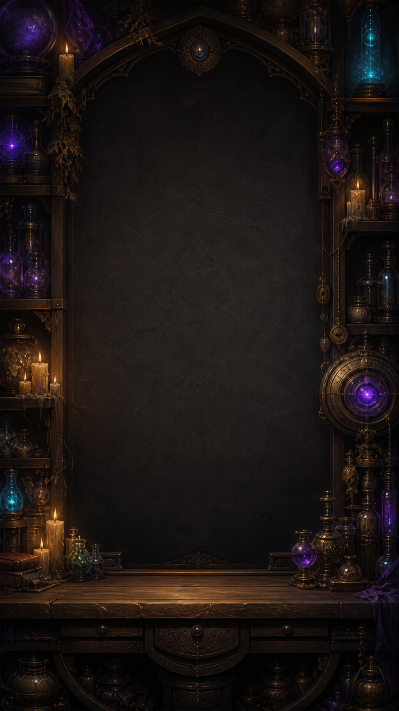

<div align="center">
  

  # Aether Vials: Arcane Brew

  **A handcrafted offline liquid-sorting puzzle for iOS, built with SwiftUI and SpriteKit.**

  [](https://swift.org)
  [](https://developer.apple.com/ios/)
  [](https://developer.apple.com/xcode/swiftui/)
  [](https://developer.apple.com/spritekit/)
  [](#privacy)

  *Sort magical essences, master elemental reactions, and complete the Grand Brew.*
</div>

---

## Overview

Aether Vials is a portrait puzzle game with 30 progressively larger levels. The player pours layered magical essences between glass vials until every non-empty vial contains one pure essence.

The project combines native SwiftUI navigation with a persistent SpriteKit board. Game rules live in a UI-independent Swift engine, so animation never decides whether a move is valid.

<table>
  <tr>
    <td width="50%"></td>
    <td width="50%"></td>
  </tr>
  <tr>
    <td align="center"><b>Alchemy Path</b></td>
    <td align="center"><b>Arcane Laboratory</b></td>
  </tr>
</table>

## Highlights

- **30 handcrafted levels** scaling from an approachable introduction to a 30-vial finale.
- **Eight readable essences** with unique colors, runes, materials, and visual effects.
- **Responsive SpriteKit interactions** with selection glow, animated pouring, merging liquids, particles, errors, and haptics.
- **Deterministic game engine** for move validation, grouped transfers, reactions, undo, restart, win detection, and hints.
- **Arcane reactions** including Frost, Nature, Aether, Light/Shadow polarity, and Void.
- **BFS solver and level validation** kept outside the normal runtime path.
- **Player progression and statistics** persisted locally with safe recovery from invalid data.
- **Arcane Ascension finale** — a dedicated cinematic sequence after the first level-30 victory.
- **Accessibility-aware motion** with a reduced-motion finale and simplified board effects.
- **No account, ads, purchases, analytics, or network dependency.**

## Architecture

```text
AppDelegate + UITabBarController
              │
              ├── SwiftUI screens and design system
              │       └── GameViewModel (MVVM)
              │               ├── ProgressStore / UserDefaults
              │               └── GameEngine (pure Swift rules)
              │
              └── SpriteKit GameScene
                      └── Persistent multi-layer vial nodes
```

| Layer | Responsibility |
| --- | --- |
| **SwiftUI** | App screens, navigation, controls, statistics, onboarding, and finale cards |
| **SpriteKit** | Vial rendering, liquid masks, pouring, selection, particles, reactions, and finale animation |
| **GameEngine** | Legal moves, transfer plans, grouped layers, reactions, undo, hints, and victory |
| **ViewModel** | Coordinates engine results with animation completion and published UI state |
| **ProgressStore** | Levels, best moves, settings, statistics, daily streak, and finale unlock |
| **JSON catalog** | Data-driven definitions for all 30 levels |

### Why the hybrid approach?

SwiftUI is ideal for the app shell and accessible controls, while SpriteKit provides precise, performant animation for the board. The scene keeps vial nodes alive instead of rebuilding the board on every tap. A move is committed by the engine first, visualized by SpriteKit, and published to the interface only when the animation completes.

## Element system

| Essence | Visual identity | Gameplay role |
| --- | --- | --- |
| Water | Deep blue, waves, bubbles | Core sortable essence |
| Fire | Red-orange, inner sparks | Arcane reaction essence |
| Frost | Ice blue, crystals | Freezes a vial temporarily |
| Nature | Green, golden pollen | Reacts with Water |
| Aether | Magenta, star shimmer | Copies nearby magic |
| Light | Gold, soft rays | Cannot touch Shadow |
| Shadow | Violet, drifting haze | Cannot touch Light |
| Void | Ink purple, bright rim | Absorbs one compatible layer |

## Engineering details

- Persistent `SKNode` hierarchy with no full scene rebuild during ordinary taps.
- Grouped transfers move one continuous run of matching top layers as a single turn.
- Three visual detail modes keep 10–30 vials readable and responsive on compact phones.
- Invisible hit targets remain at least 44 × 44 pt even for compact vial artwork.
- Gameplay remains deterministic; SpriteKit visualizes engine events but never owns the rules.
- Undo restores the complete pre-move state, including reaction side effects.
- The solver uses canonical state keys and the same public rules as the live game.
- Statistics distinguish completed levels, perfect brews, pours, hints, streak, favorite essence, and active laboratory time.

## Requirements

- macOS with Xcode
- iOS 15.6 or later
- Portrait iPhone target

## Run locally

1. Clone the repository:

   ```bash
   git clone git@github.com:andreyboyarko/RunicCrucibleAetherBrew.git
   cd RunicCrucibleAetherBrew
   ```

2. Open `RunicCrucibleAetherBrew.xcodeproj` in Xcode.
3. Select the `RunicCrucibleAetherBrew` scheme and an iPhone simulator.
4. Build and run with `⌘R`.

No API keys, package installation, or backend configuration are required.

## Tests

The XCTest target covers core transfer rules, grouped pours, reaction behavior, undo, level validation, hint legality, persistence, player statistics, and the level-30 finale unlock.

```bash
xcodebuild \
  -project RunicCrucibleAetherBrew.xcodeproj \
  -scheme RunicCrucibleAetherBrew \
  -destination 'platform=iOS Simulator,name=iPhone SE (3rd generation)' \
  test
```

## Privacy

Aether Vials is fully offline. Gameplay progress and preferences are stored locally with `UserDefaults`. The app has no account system, advertising SDK, analytics SDK, or remote game service.

## Project status

This repository is maintained as an iOS engineering and game-design portfolio project. The current build contains the complete 30-level offline experience and its finale.

## Usage and artwork

The source code is publicly visible for review and educational reference. No open-source license is granted at this time. All original artwork, branding, and game assets remain the property of the repository owner and may not be redistributed or reused without permission.

---

<div align="center">
  Built with SwiftUI, SpriteKit, and a suspicious amount of alchemy.
</div>
